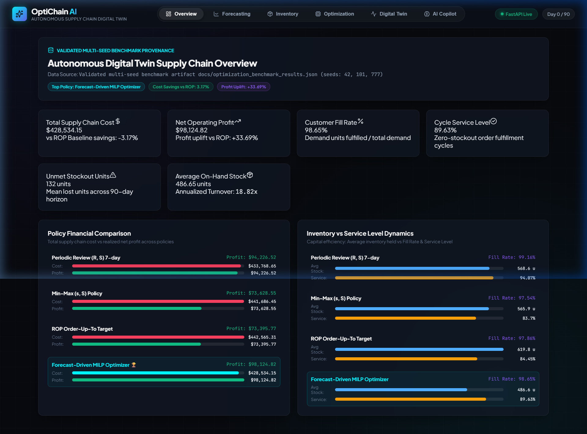
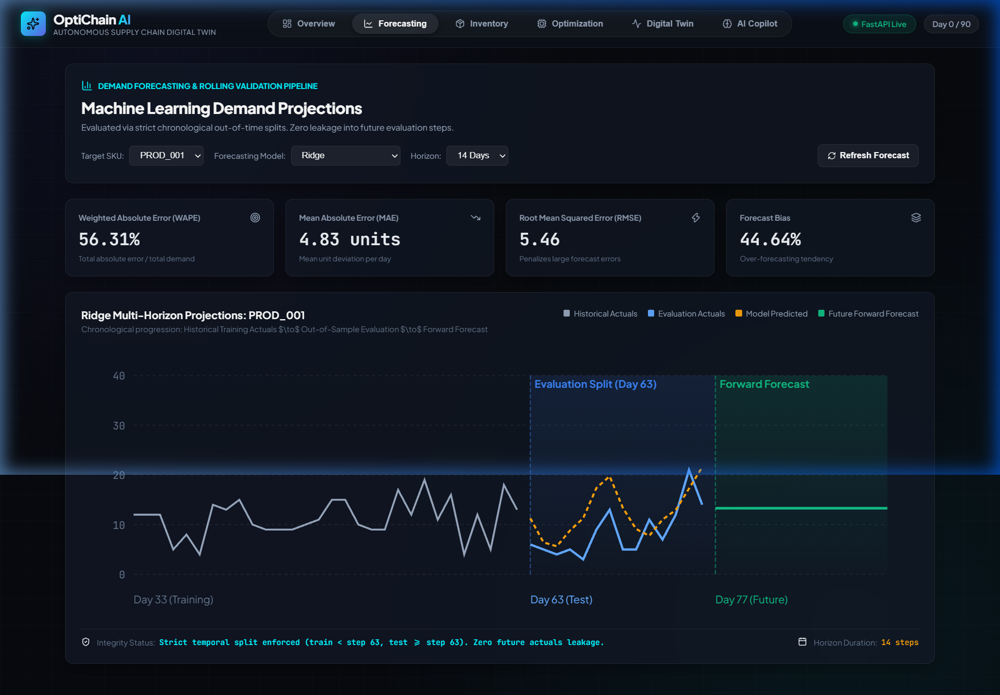
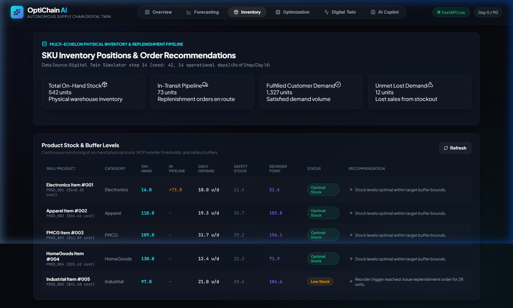
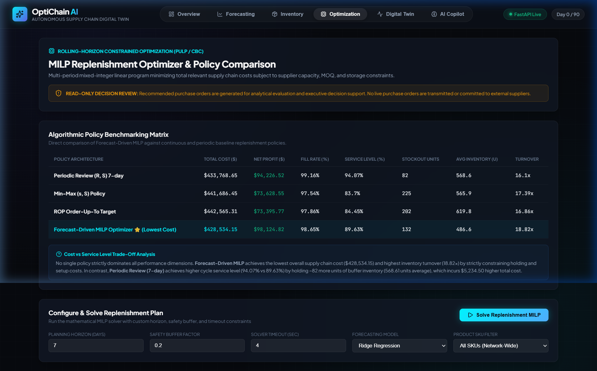

# OptiChain AI 🌐⚡
### Autonomous Multi-Echelon Supply Chain Digital Twin & Optimization Platform

[](https://python.org)
[](https://pytest.org)
[](https://coin-or.github.io/pulp/)
[](https://fastapi.tiangolo.com)
[](https://vitejs.dev)
[](https://docker.com)
[](.github/workflows/ci.yml)

OptiChain AI is an enterprise-grade autonomous supply chain management and digital twin platform that unites **Machine Learning Demand Forecasting** (LightGBM, Ridge, Seasonal Naive), **Operations Research** (Constrained Rolling-Horizon Mixed-Integer Linear Programming via PuLP/CBC), **Reproducible MLOps Experiment Tracking**, and an **Interactive Analytical React Dashboard** backed by a verified **FastAPI REST Service**.

---

## 🎯 Executive Problem Statement

Modern distribution and retail enterprises manage complex multi-warehouse networks subject to non-stationary demand patterns (seasonality, promotional spikes, demand shocks) and stochastic lead times (supplier backlogs, transit delays, port congestion). Traditional static heuristics like Min-Max $(s, S)$ or Reorder Point ($ROP$) frequently suffer from:
1. **Working Capital Inefficiency**: Bloated holding costs during low-demand periods.
2. **Catastrophic Stockout Cascades**: Severe stockout penalties ($1.2\times - 1.5\times$ profit margin) when supplier lead times spike unexpectedly.
3. **Black-Swan Brittleness**: Inability to proactively adjust replenishment ahead of systemic disruptions.

**OptiChain AI** solves this through a closed-loop digital twin that simulates, predicts, optimizes, and visualizes multi-echelon replenishment decisions in real time.

---

## 📸 Interactive Dashboard Views

Real screenshots captured directly from the live OptiChain AI web application:

| Executive Overview & Policy Comparison | Demand Forecasting & Accuracy Metrics |
|:---:|:---:|
|  |  |
| *Executive KPI summary, baseline comparisons, and cost vs. profit trade-offs.* | *Rolling-origin actuals vs. model forecasts with WAPE, MAE, RMSE, and Bias.* |

| Inventory Position & Pipeline Tracking | MILP Replenishment Optimization |
|:---:|:---:|
|  |  |
| *Strict physical on-hand stock vs. in-transit pipeline stock distinction.* | *COIN-OR CBC solver diagnostics, proven optimality status, and PO schedules.* |

---

## 🏛️ System Architecture

```mermaid
graph TD
    Client[Web Browser / Analyst Dashboard] -->|HTTP /port 80| Nginx[Frontend Nginx Container]
    Nginx -->|Static Assets /| Static[React 19 SPA Build]
    Nginx -->|Reverse Proxy /api/| Backend[FastAPI Backend /port 8000]
    Nginx -->|Reverse Proxy /docs| Docs[Swagger OpenAPI]
    
    subgraph Data & Simulation Engine
        DG[Demand & Disruption Generator] --> DT[Digital Twin Discrete-Time Simulator]
        DT --> STATE[State Engine: Inventory, Pipelines, Lead Times]
        DT --> COST[Cost Engine: Holding, Stockout, Ordering, Transport]
    end

    subgraph Optimization & Policy Layer
        BASE[Heuristic Baselines: (s, S), ROP, (R, S)] --> EVAL[Benchmark Evaluator]
        FORECAST[ML Forecasting: Ridge / LightGBM / Seasonal Naive] --> OR[Operations Research: Constrained MILP Planner]
        OR --> EVAL
    end

    subgraph MLOps & Delivery
        EVAL --> ARTIFACTS[Canonical Benchmark Artifacts in docs/]
        OR --> EXP[MLOps Experiment Tracker: JSON / JSONL Registry]
        FORECAST --> EXP
        DT --> EXP
    end

    Backend --> OR
    Backend --> FORECAST
    Backend --> DT
    Backend --> ARTIFACTS
    Backend --> EXP
```

---

## 📊 Validated Multi-Seed Benchmark Results

Multi-seed evaluation across seeds `42`, `101`, and `777` on a 90-day horizon (1 Warehouse, 5 Products, 3 Suppliers) under stochastic lead times and active disruptions:

| Policy / Algorithm Paradigm | Fill Rate (%) | Service Level (%) | Total Cost ($) | Mean Net Profit ($) | Stockout Units | Avg Inventory (Units) | Inventory Turnover |
|---|---|---|---|---|---|---|---|
| **Forecast-Driven MILP Optimizer** | **98.65%** | **89.63%** | **$428,534.15** | **$98,124.82** | **132.0** | **486.65** | **18.82x** |
| **Periodic Review (R, S) 7-day** | 99.16% | 94.07% | $433,768.65 | $94,226.52 | 81.7 | 568.61 | 16.10x |
| **Min-Max (s, S) Policy** | 97.54% | 83.70% | $441,686.45 | $73,628.55 | 225.3 | 565.85 | 17.39x |
| **ROP Order-Up-To Target** | 97.86% | 84.45% | $442,565.31 | $73,395.77 | 201.7 | 619.77 | 16.86x |

### Algorithmic Insights & Trade-offs:
1. **Cost Savings & Working Capital**: Forecast-Driven MILP achieves **3.17% total cost reduction** ($14,031.16 savings vs ROP) and **+33.69% net profit uplift** ($24,729.05 uplift) by holding 21.5% less average inventory (486.65 vs 619.77 units) with high capital velocity (18.82x turnover).
2. **Cost vs Service Level Trade-Off**: No single policy strictly wins every metric. Periodic Review achieves higher service level (94.07% vs 89.63%) but incurs higher total cost ($433,768.65) and carries 82 more units of buffer stock.
3. **Mathematical Solvability**: Across 270 rolling solves in the benchmark, 264 were mathematically **Proven Optimal** and 6 terminated at the time-limit with a **Feasible Incumbent** (honestly classified without threshold inference).

---

## 🔬 Reproducible MLOps Experiment Tracking

OptiChain AI features a lightweight, file-based experiment tracking registry (`optichain/mlops/experiment_tracker.py`):
- **Immutable Run Records**: Individual runs stored as `artifacts/experiments/run_<run_id>.json`.
- **Fast Registry Index**: Searchable `artifacts/experiments/experiment_registry.jsonl`.
- **Canonical Benchmark Safety**: Experiment tracking paths are isolated from canonical benchmark artifacts (`docs/`).
- **Comprehensive Metadata**: Captures Git commit hash, UTC timestamp, simulation seeds, formal metric definitions, multi-seed dispersion (mean and sample standard deviation with Bessel's correction $n-1$), and CBC solver diagnostics.

### Using the Experiment CLI:
```bash
# List recent experiment runs in the registry
python scripts/track_experiment.py list

# Inspect detailed JSON for a specific run
python scripts/track_experiment.py show <run_id>

# Compare multiple runs side-by-side in tabular format
python scripts/track_experiment.py compare <run_id_1> <run_id_2>

# Record a verified sample benchmark run
python scripts/track_experiment.py sample
```

---

## 🛠️ Technology Stack & Key Engineering Decisions

| Domain | Technology | Key Engineering Decisions |
|---|---|---|
| **Backend & REST API** | Python 3.11, FastAPI, Pydantic v2, Uvicorn | Strict schema validation, sanitized global exception handling, configurable CORS. |
| **Operations Research** | PuLP 2.8, COIN-OR CBC | Branch-and-cut MILP with MOQ, supplier capacities, lead times, and solver status verification. |
| **Demand Forecasting** | LightGBM, Scikit-learn (Ridge) | Strict rolling-origin train/test split (Days 0..62 train, Days 63..89 test) with 0 future leakage. |
| **Digital Twin Simulator** | NumPy, Pandas, SciPy | Strict inventory conservation invariant: $I_t = \max(0, I_{t-1} + D_t - S_t)$. |
| **Frontend Dashboard** | React 19, Vite, Recharts, Lucide | Responsive SPA, physical vs. pipeline stock separation, dynamic model/SKU controls. |
| **Reverse Proxy & Delivery** | Docker, Docker Compose, Nginx | Multi-stage Docker builds, Alpine Nginx reverse proxy routing `/api/` to avoid CORS issues. |
| **CI / CD Pipeline** | GitHub Actions | Pytest test execution (132 tests), coverage enforcement, npm lockfile build verification. |

---

## 🚀 Quickstart & Setup Commands

### Option A: 1-Step Docker Compose Deployment (Recommended)
```bash
# Clone the repository
git clone https://github.com/your-username/OptiChain.git
cd OptiChain

# Build and start both containers in background
docker compose up --build -d

# Verify container health
docker compose ps
```
Access the application:
- **Interactive Web Dashboard:** `http://localhost:80`
- **FastAPI OpenAPI Documentation:** `http://localhost:8000/docs` (or `http://localhost:80/docs`)
- **Backend Health Check:** `http://localhost:8000/api/v1/health`

### Option B: Local Development Setup

#### 1. Python Backend Setup
```bash
# Create and activate virtual environment
python -m venv .venv
source .venv/bin/activate  # On Windows: .venv\Scripts\activate

# Install dependencies (including COIN-OR CBC solver on your system)
pip install -r requirements.txt

# Run complete test suite (132 tests)
pytest tests -v

# Launch FastAPI backend
python -m uvicorn optichain.api.main:app --port 8000 --reload
```

#### 2. React Frontend Setup (in a separate terminal)
```bash
cd frontend

# Install dependencies using lockfile
npm ci

# Launch Vite dev server
npm run dev -- --port 5173
```
Open **`http://localhost:5173`** in your browser.

---

## 🔌 REST API Endpoints Overview

All endpoints are hosted under `/api/v1`:

| Method | Endpoint | Description |
|---|---|---|
| `GET` | `/api/v1/health` | Service health status, CBC solver verification, and benchmark artifact presence. |
| `GET` | `/api/v1/dashboard/summary` | Executive KPI summary (Total Cost, Net Profit, Fill Rate, Stockouts, Turnover). |
| `GET` | `/api/v1/benchmarks` | Full 4-policy benchmark data with per-seed dispersion and cost breakdowns. |
| `GET` | `/api/v1/forecasts` | Out-of-sample predictions, forward projections, and accuracy metrics (WAPE, MAE, RMSE, Bias). Supports single SKU or `product_id="ALL"`. |
| `GET` | `/api/v1/inventory` | Product-level physical inventory, in-transit pipeline orders, ROP thresholds, and stock status. |
| `POST` | `/api/v1/optimization/recommendations` | Solves rolling-horizon MILP via PuLP/CBC, returning recommended purchase orders and solver diagnostics. |
| `POST` | `/api/v1/simulation/run` | Controlled digital twin simulation execution with input validation and seed determinism. |

For interactive documentation, visit [http://localhost:8000/docs](http://localhost:8000/docs).

---

## ⚖️ Known Limitations & Provenance Disclosure

1. **Synthetic Digital Twin**: All demand variations, supplier catalogs, and warehouse inventory positions are simulated deterministically from seedable mathematical models. The platform is designed for research, portfolio demonstration, and algorithm development.
2. **Read-Only Decision Support**: Replenishment recommendations produced by the MILP solver are strictly decision-support calculations. No automated purchase orders are placed with external ERP/WMS systems.
3. **In-Memory State**: The digital twin runs in memory without an external persistent database or user authentication layer. See [docs/DEPLOYMENT.md](docs/DEPLOYMENT.md) for production enterprise deployment patterns.
4. **CBC Solver Bounds**: PuLP invokes COIN-OR CBC as an external sub-process. A strict timeout (`time_limit_sec=5` by default) prevents hung MILP solves, falling back to feasible incumbents or heuristic baselines if the time limit expires.

---

## 📖 Further Documentation

- [Deployment & Operations Guide](docs/DEPLOYMENT.md): Containerization, cloud hosting, CORS configuration, and troubleshooting.
- [Phase 5 Verification Audit](docs/PHASE5_VERIFICATION_AUDIT.md): Complete test results, metric reconciliations, and solver status verification.
- [Digital Twin Simulation Engine](docs/DIGITAL_TWIN.md): Mathematical modeling of mass-conservation inventory dynamics.
- [Demand Forecasting Engine](docs/FORECASTING.md): Feature engineering, models, and rolling-origin evaluation.
- [MILP Optimization Framework](docs/OPTIMIZATION.md): Mathematical formulation of the constrained replenishment model.

---

## 📜 License
MIT License. Built for autonomous supply chain optimization, operations research, and portfolio demonstration.
