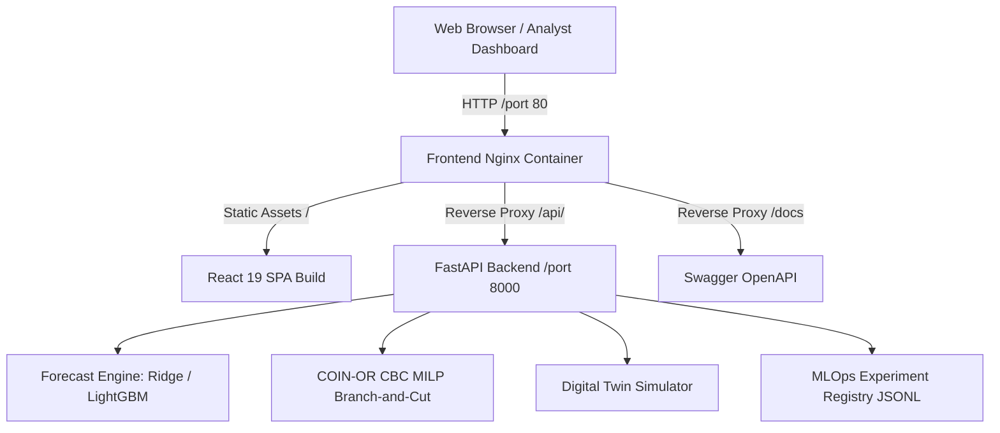

# OptiChain AI — Production Deployment & Operations Guide

**System:** OptiChain AI — Autonomous Supply Chain Optimization & Digital Twin  
**Version:** 1.0.0 (Phase 6 MLOps & Production Release)  
**Authors:** Senior Full-Stack & MLOps Engineering Team  

---

## 1. System Architecture Overview

OptiChain AI is decoupled into a high-performance Python FastAPI backend and an interactive React 19 / Vite single-page application (SPA).



### Key Components
1. **Frontend**: React 19, Vite, Recharts, Lucide React, Vanilla CSS design system.
2. **Reverse Proxy & Static Server**: Alpine Nginx with gzip compression, SPA history fallback, and `/api/` reverse proxy.
3. **Backend API**: FastAPI, Pydantic v2, Uvicorn ASGI server.
4. **Optimization Engine**: Mixed-Integer Linear Programming (MILP) solver powered by PuLP and COIN-OR CBC (`coinor-cbc`).
5. **Machine Learning Forecasting**: Scikit-learn (Ridge), LightGBM, and Seasonal Naive lag baselines with rolling-origin temporal splits.
6. **MLOps Registry**: Lightweight file-based experiment tracker (`optichain/mlops/experiment_tracker.py`) recording reproducible runs, Git commit hashes, and multi-seed statistics.

---

## 2. Environment Variables & Configuration

OptiChain AI cleanly separates **build-time** frontend parameters from **runtime** backend parameters.

| Variable | Scope | Target | Default | Description |
|---|---|---|---|---|
| `VITE_API_BASE_URL` | Build-time | Frontend | `""` (in Docker) / `http://localhost:8000` (local dev) | Base URL for API requests. Set to empty string when using Nginx reverse proxy so requests are relative (`/api/v1/...`). |
| `ALLOWED_ORIGINS` | Runtime | Backend | `http://localhost:5173,http://localhost:3000,http://localhost:80,http://localhost` | Comma-separated list of permitted CORS origins. Never set to `*` with credentials. |
| `PORT` | Runtime | Backend | `8000` | Port for Uvicorn ASGI server. |
| `HOST` | Runtime | Backend | `0.0.0.0` | Host bind address for Uvicorn. |
| `LOG_LEVEL` | Runtime | Backend | `INFO` | Python logging severity level (`DEBUG`, `INFO`, `WARNING`, `ERROR`). |
| `EXPERIMENTS_OUTPUT_DIR` | Runtime | Backend / CLI | `artifacts/experiments` | Destination directory for MLOps experiment runs. Cannot point to `docs/`. |

---

## 3. Local Deployment via Docker Compose

### Prerequisites
- Docker Engine 24+ and Docker Compose v2.
- 2 GB RAM and 2 CPU cores minimum.

### 1-Step Orchestration
```bash
# Build and start both containers in the background
docker compose up --build -d
```

### Verification & Health
```bash
# Inspect container health statuses
docker compose ps

# Tail logs
docker compose logs -f

# Verify backend health endpoint directly
curl -i http://localhost:8000/api/v1/health

# Verify frontend Nginx health check
curl -i http://localhost:80/nginx-health
```

The application will be accessible at:
- **Interactive Dashboard:** `http://localhost:80`
- **FastAPI REST API Docs:** `http://localhost:8000/docs` (or `http://localhost:80/docs` via Nginx)
- **API Health Check:** `http://localhost:8000/api/v1/health`

### Shutdown
```bash
docker compose down
```

---

## 4. Standalone Container Deployment

### 4.1 Backend Container
```bash
# Build backend image
docker build -t optichain-backend:latest -f Dockerfile .

# Run backend container
docker run -d \
  --name optichain-backend \
  -p 8000:8000 \
  -e ALLOWED_ORIGINS="http://localhost:5173,http://localhost:80,http://localhost" \
  optichain-backend:latest

# Verify health
curl -f http://localhost:8000/api/v1/health
```

### 4.2 Frontend Container
```bash
# Build frontend image (relative API URLs reverse-proxied by Nginx)
docker build -t optichain-frontend:latest -f frontend/Dockerfile ./frontend

# Run frontend container on port 80
docker run -d \
  --name optichain-frontend \
  -p 80:80 \
  optichain-frontend:latest
```

---

## 5. Cloud Hosting Options

### 5.1 Unified Container Service (Google Cloud Run / AWS ECS / Render / Fly.io)
The backend container is completely self-contained. It packages:
- Python 3.11 runtime.
- COIN-OR CBC C++ solver binary (`coinor-cbc`, `coinor-libcbc-dev`).
- Precomputed benchmark artifacts in `docs/`.

**Deployment Checklist for Cloud Run / ECS:**
1. Push `optichain-backend` to container registry (e.g. AWS ECR or Google Artifact Registry).
2. Configure environment variable: `ALLOWED_ORIGINS=https://app.yourdomain.com`.
3. Set CPU to at least 1 vCPU and memory to 1 GB.
4. Configure HTTP Health Check path to `/api/v1/health` with `HTTP 200` expectation.

### 5.2 Decoupled Frontend (Vercel / Netlify / Cloudflare Pages)
If deploying the frontend as a static SPA on a Jamstack CDN:
1. Set Root Directory to `frontend`.
2. Build Command: `npm run build`.
3. Output Directory: `dist`.
4. Configure Build Environment Variable:
   ```bash
   VITE_API_BASE_URL=https://api.yourdomain.com
   ```
5. Ensure `https://yourdomain.com` is added to `ALLOWED_ORIGINS` on the backend server.

---

## 6. Security & Operational Boundaries

### 6.1 Security Posture
- **No Hardcoded Secrets**: Zero API keys, passwords, or deployment tokens are stored in the codebase.
- **Restricted CORS**: The backend rejects arbitrary origins by default. Origins must be explicitly whitelisted in `ALLOWED_ORIGINS`.
- **Sanitized Exception Handling**: The global exception handler catches unhandled exceptions, logs full tracebacks to backend logs, and returns sanitized generic error JSON without exposing filesystem paths.
- **Non-Root Container Execution**: The backend Dockerfile creates and runs under an unprivileged user (`appuser`, UID 1000).

### 6.2 Operational Boundaries & Intentional Limitations
- **Synthetic Digital Twin**: All demand series, supplier catalogs, and warehouse inventory positions are simulated deterministically from seedable models. The platform does NOT connect to live ERP/WMS systems (e.g., SAP, Manhattan Associates).
- **Non-Destructive Optimization**: Order recommendations generated by `/api/v1/optimization/recommendations` are planning recommendations. They do NOT submit automated purchase orders to external vendors.
- **In-Memory State**: The digital twin simulator runs in memory. There is currently no persistent SQL database or authentication layer (OAuth2 / JWT). In a multi-tenant enterprise deployment, an authentication gateway and PostgreSQL metadata store should be placed in front of the API.
- **CBC Solver Bounds**: PuLP invokes COIN-OR CBC as an external sub-process. A strict timeout (`time_limit_sec=5` by default) prevents hung MILP solves, falling back to feasible incumbents or heuristic baselines if the time limit expires.

---

## 7. Troubleshooting & Diagnostics

| Symptom | Probable Cause | Diagnostic Command | Remediation |
|---|---|---|---|
| `GET /api/v1/health` returns `status="degraded"` | `coinor-cbc` binary missing or benchmark artifacts not found | `curl http://localhost:8000/api/v1/health` | Ensure `docs/optimization_benchmark_results.json` exists; install `coinor-cbc` via apt-get. |
| Frontend displays CORS error in browser console | Origin not in `ALLOWED_ORIGINS` | Inspect browser console network headers | Add the client domain/port to `ALLOWED_ORIGINS` in `.env`. |
| 503 on `/api/v1/dashboard/summary` | Missing canonical benchmark artifact | Check `docs/` directory | Run `python scripts/audit_optimization.py` to regenerate artifacts. |
| Frontend cannot reach backend in Docker | `VITE_API_BASE_URL` pointing to localhost inside container | Check Nginx proxy logs | Use default `VITE_API_BASE_URL=""` so Nginx reverse-proxies `/api/` to `backend:8000`. |
| CBC solver time warning in PuLP | Deprecated `PULP_CBC_CMD` API in PuLP 2.8 | Review backend stderr | Informational warning only; solver execution is verified deterministic. |
