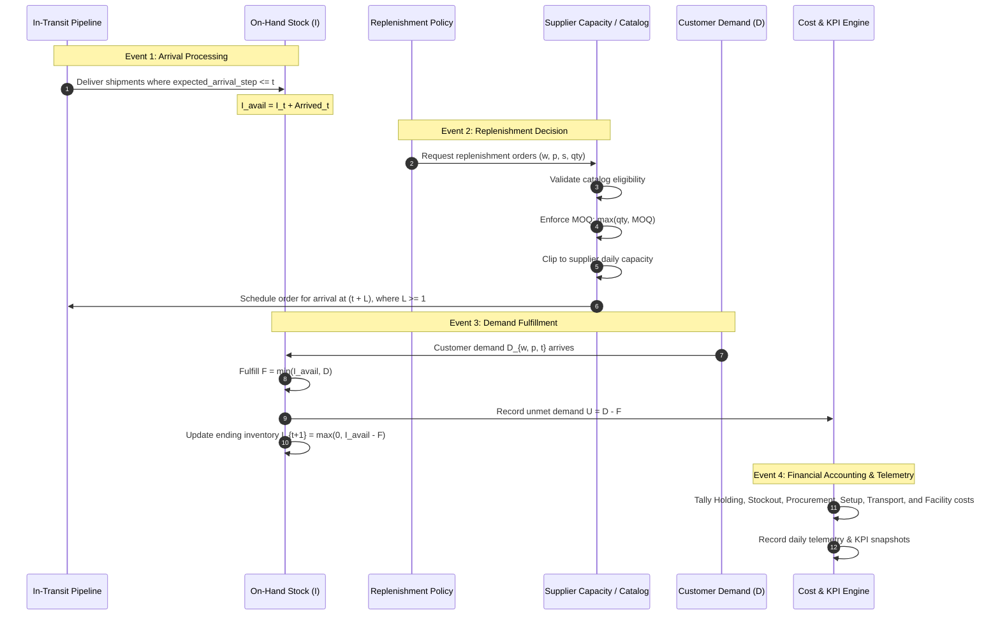

# OptiChain AI - Phase 2: Digital Twin Simulator & Heuristic Baselines

This document details the discrete-time state transitions, event execution ordering, constraint handling, heuristic policy formulations, cost accounting rules, and known limitations of the **Digital Twin Simulator**.

---

## 1. Simulation Architecture & Discrete-Time Mechanics

The simulator runs across a discrete daily review horizon $t \in [0, T-1]$ (where $T=90$ days by default).

### Phase 2 Baseline Topology:
- **Warehouses ($W=1$)**: Regional Distribution Center `WH_01`.
- **Products ($P=5$)**: SKUs `PROD_001` through `PROD_005` (Electronics, FMCG, Apparel, Home Goods, Industrial).
- **Suppliers ($S=3$)**: Tier-1 Suppliers `SUP_01` through `SUP_03`.
- **Review Epoch**: Daily ($\Delta t = 1$ calendar day).

---

## 2. Event Ordering Protocol per Simulation Step $t$

To eliminate race conditions, double-counting, lookahead bias, and circular dependencies, `DigitalTwinSimulator.step()` strictly executes the following sequence:

### Event Sequence Details:

1. **Inbound Delivery Arrival Processing**:
   - Inspects all orders currently in `in_transit_orders`.
   - Any order with `expected_arrival_step <= t` is transitioned to `OrderStatus.DELIVERED` with `actual_arrival_step = t`.
   - Units are added to `on_hand`: $I_{\text{avail}} = I_t + \sum \text{Arrived}$.
   - Delivered orders are permanently removed from the active in-transit queue (preventing double-counting).

2. **Replenishment Order Issuance & Constraint Checks**:
   - Policy inspects the state observation and issues replenishment orders: $(w, p, s) \mapsto \text{qty}$.
   - **Catalog Eligibility**: If $p \notin \text{supplier.catalog}$, the order is strictly rejected.
   - **Minimum Order Quantity (MOQ)**: If $\text{qty} > 0$, the order is elevated to $\max(\text{qty}, \text{MOQ}_{s, p})$.
   - **Supplier Daily Capacity**: The cumulative orders dispatched to supplier $s$ for SKU $p$ across all warehouses on step $t$ cannot exceed $\text{daily\_capacity}_{s, p}$.
   - **Stochastic Lead Time ($L \ge 1$)**: Lead time $L$ is sampled from the Gaussian distribution with delivery reliability and active disruption multipliers. The arrival is scheduled for $\tau = t + L \ge t + 1$.
   - **Fixed Setup Cost**: $K_s$ is charged once per supplier receiving at least one purchase order at step $t$.

3. **Customer Demand Realization & Fulfillment**:
   - Customer demand $D_{w, p, t}$ is realized from the non-stationary demand matrix.
   - Available on-hand inventory is checked:
     $$F_{w, p, t} = \min(I_{w, p, t}, D_{w, p, t})$$
     $$U_{w, p, t} = D_{w, p, t} - F_{w, p, t}$$
   - Ending inventory is updated:
     $$I_{w, p, t+1} = \max(0, I_{w, p, t} - F_{w, p, t})$$
   - Under lost sales mode (`backlog_unmet_demand=False`), unmet demand represents permanently lost sales and brand penalty.

4. **Financial Accounting & Telemetry**:
   - Costs and revenues are computed using exact balance-sheet equations and recorded in `CostEngine`.
   - Granular multi-dimensional tensors (`history_on_hand`, `history_demand`, `history_fulfilled`, `history_unmet`, `history_arrivals`, `history_pipeline`) record step data for auditability.

---

## 3. Inventory Position & Duplicate Order Prevention

### 3.1 Inventory Position Definition
A core failure mode in naïve inventory controllers is placing duplicate replenishment orders while previous orders are still traveling in the pipeline. To eliminate this, all baseline policies evaluate the **Inventory Position ($IP$)**:

$$IP_{w, p, t} = \text{OnHand}_{w, p, t} + \text{InTransit}_{w, p, t} - \text{Backlog}_{w, p, t}$$

Where:
- $\text{OnHand}_{w, p, t}$: Physical stock physically available at the warehouse.
- $\text{InTransit}_{w, p, t} = \sum_{o \in \mathcal{O}_{\text{in-transit}}} \text{quantity}(o)$: All scheduled, outstanding purchase orders currently en route.
- $\text{Backlog}_{w, p, t}$: Unfulfilled customer backorders (0 under lost sales).

### 3.2 Duplicate Order Prevention Mechanism
When an order of $Q$ units is placed at day $t$, it enters `in_transit_orders`. At day $t+1$, `InTransit` increases by $Q$, which raises $IP_{w, p, t+1}$ by $Q$. Consequently, on days $t+1, t+2, \dots$ until delivery, $IP$ remains above the reorder threshold, preventing duplicate "phantom" replenishment orders.

---

## 4. Heuristic Baseline Policy Formulations

### 4.1 Reorder Point (ROP) with Order-Up-To Target
Continuous review $(ROP, \text{Target})$ policy:
- **Lead-Time Demand Variance**: $\sigma_{DL}^2 = \bar{L} \sigma_D^2 + \bar{D}^2 \sigma_L^2$
- **Safety Stock**: $SS = z \cdot \sqrt{\max(0.1, \sigma_{DL}^2)}$, where $z=1.65$ ($\approx 95\%$ cycle service level).
- **Reorder Point**: $ROP = \bar{D} \cdot \bar{L} + SS$
- **Economic Order Quantity ($EOQ$)**: $EOQ = \sqrt{\frac{2 \bar{D}_{\text{annual}} K}{h}}$
- **Order-Up-To Target**: $T_{\text{target}} = ROP + EOQ$
- **Replenishment Decision**:
  $$\text{If } IP_{w, p, t} \le ROP \implies \text{Order } Q = \lceil T_{\text{target}} - IP_{w, p, t} \rceil$$

### 4.2 Min-Max $(s, S)$ Policy
Continuous review Scarf base-stock policy:
- Minimum threshold $s = \bar{D} \cdot \bar{L} + SS$.
- Maximum target $S = s + EOQ$.
- **Replenishment Decision**:
  $$\text{If } IP_{w, p, t} \le s \implies \text{Order } Q = \lceil S - IP_{w, p, t} \rceil$$

### 4.3 Periodic Review $(R, S)$ Policy
Fixed review interval policy (reviewed every $R=7$ days):
- Protection interval is $(R + \bar{L})$ days.
- Target level $S = \bar{D} \cdot (R + \bar{L}) + z \cdot \sigma_D \sqrt{R + \bar{L}}$.
- **Replenishment Decision**:
  $$\text{If } (t \pmod R == 0) \text{ and } IP_{w, p, t} < S \implies \text{Order } Q = \lceil S - IP_{w, p, t} \rceil$$
  On non-review days ($t \pmod R \ne 0$), no orders are placed.

---

## 5. Cost Accounting Formulations & Key Performance Indicators

### 5.1 Financial Cost Breakdown
$$\text{Total Cost}_t = C_{\text{holding}} + C_{\text{stockout}} + C_{\text{order}} + C_{\text{procurement}} + C_{\text{transport}} + C_{\text{operating}}$$

Where:
- **Holding Cost**: $C_{\text{holding}} = \sum_{w, p} h_p \cdot I_{w, p, t+1}$
- **Stockout Penalty**: $C_{\text{stockout}} = \sum_{w, p} p_p \cdot U_{w, p, t}$
- **Fixed PO Setup Cost**: $C_{\text{order}} = \sum_{s} K_s \cdot \mathbb{I}(\text{OrdersPlaced}(s, t) > 0)$
- **Procurement Cost**: $C_{\text{procurement}} = \sum_{w, p, s} c_{p, s} \cdot q_{w, p, s, t}$
- **Transportation Cost**: $C_{\text{transport}} = \tau \cdot \sum q$
- **Facility Operating Cost**: $C_{\text{operating}} = \sum_w F_w$

### 5.2 Key Performance Indicators (KPIs)
- **Fill Rate (OTIF)**:
  $$\text{Fill Rate} = \frac{\sum_{t=0}^{T-1} \sum_{w, p} F_{w, p, t}}{\sum_{t=0}^{T-1} \sum_{w, p} D_{w, p, t}} \times 100\%$$
- **Alpha Service Level ($\alpha$-SL)**:
  $$\alpha\text{-SL} = \frac{1}{T} \sum_{t=0}^{T-1} \mathbb{I}\left(\sum_{w, p} U_{w, p, t} == 0\right) \times 100\%$$
- **Inventory Turnover Ratio**:
  $$\text{Turnover} = \frac{\text{Cumulative Cost of Goods Sold (COGS)}}{\text{Average Inventory Value}}$$

---

## 6. Multi-Seed Benchmark Evaluation (Phase 2 Baseline)

Evaluated across **3 matched random seeds [42, 101, 777]** under active black-swan disruptions (Viral Demand Surge Days 25–32, Supplier Factory Delay Days 45–55):

| Policy | Fill Rate (%) | Service Level (%) | Total Cost ($) | Stockout Units | Avg Inventory (Units) | Holding Cost ($) | Stockout Cost ($) | Procurement Cost ($) | Net Profit ($) | Turnover |
|---|---|---|---|---|---|---|---|---|---|---|
| **Periodic Review (R, S) 7-day** | **99.15%** | **94.44%** | **$433,772.95** | **79** | 569.31 | $7,697.72 | **$7,586.01** | $359,498.35 | **$94,304.05** | 16.08x |
| **Min-Max (s, S) Policy** | 97.51% | 83.70% | $441,700.58 | 224 | **566.05** | **$6,545.00** | $19,976.71 | $355,286.99 | $73,585.26 | **17.39x** |
| **ROP Order-Up-To Target** | 97.83% | 84.45% | $442,575.89 | 200 | 619.92 | $6,680.22 | $19,385.95 | $356,381.38 | $73,359.86 | 16.86x |

### Algorithmic Observations:
1. **Periodic Review (R, S)** buffers demand over the $(R + L)$ window, resulting in a higher average inventory position that successfully absorbed the viral demand spike at day 25, yielding an outstanding **99.15% fill rate** and the highest net profit ($94.3k).
2. **Min-Max (s, S)** achieved lower holding costs ($6.5k vs $7.7k) and the highest inventory turnover (17.39x), but suffered higher stockout penalties ($19.9k) when supplier lead times expanded during the factory delay disruption.
3. **ROP Order-Up-To Target** tracked closely with $(s, S)$ while providing slightly higher stockout protection (200 unmet units vs 224).

---

## 7. Assumptions & Known Limitations

To maintain scientific integrity and transparent research standards, the following assumptions and limitations are explicitly noted:

1. **Daily Time Granularity**: The digital twin operates on discrete 1-day time increments. Intra-day replenishment batches or hourly queuing effects are not modeled.
2. **Single-Echelon Downstream**: Demand flows directly from retail customers to distribution center `WH_01`. Multi-tier transshipments between secondary retail stores will be introduced in subsequent multi-echelon phases.
3. **Lost Sales vs Backlog**: The default setting treats unmet demand as lost sales with penalty costs. While backlog mode is supported in `SimulationConfig`, customer cancellations over time are not dynamic.
4. **Independent Lead-Time Distributions**: Supplier lead times are sampled independently; systemic disruptions like port congestion expand lead times across affected suppliers via scalar multipliers, rather than endogenous queue simulations.
