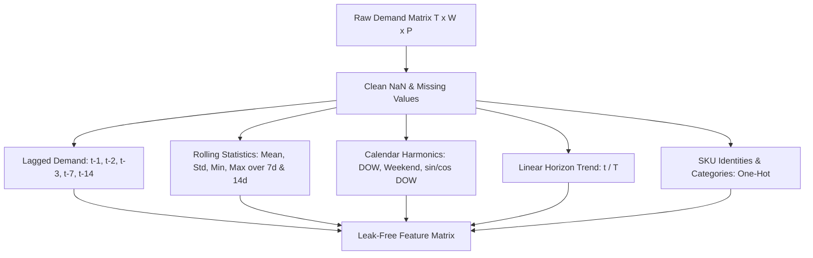

# OptiChain AI - Phase 3: Demand Forecasting ML

This document details the feature engineering pipeline, candidate models, temporal validation protocols, evaluation metrics, empirical benchmark results, execution instructions, and research limitations of the **Demand Forecasting ML Engine**.

---

## 1. Overview & Supply Chain Context

Accurate demand forecasting is the cornerstone of autonomous inventory replenishment. Under stochastic supplier lead times and non-stationary customer demand, naive heuristics either over-order (incurring excessive holding costs) or under-order (triggering costly stockout penalties).

In OptiChain AI, the forecasting engine produces multi-day forward demand projections $\hat{D}_{w, p, [t, t+H]}$ over replenishment lead times without modifying actual realized demand or leaking future ground-truth data into feature sets.

### Key Operational Invariants:
1. **Strict Separation of Predicted vs. Realized Demand**: Simulated customer demand is realized exclusively inside the digital twin simulator. Forecasting models generate estimates $\hat{D}$ that inform replenishment decisions without affecting actual customer arrivals.
2. **Zero Lookahead Leakage Guarantee**: Feature values at step $t$ are constructed strictly from historical observations $t' < t$.
3. **Multi-Product Scalability**: A unified feature pipeline handles heterogeneous product categories with SKU-level identity indicators.

---

## 2. Time-Series Feature Engineering Architecture

The [`FeatureEngineer`](file:///c:/Users/ayush/OneDrive/Desktop/created-projects/OptiChain/optichain/forecasting/features.py#L16-L98) transforms raw 3D demand tensors $(T, W, P)$ into tabular feature matrices:



### Feature Sets:
- **Autoregressive Lags**: $y_{t-1}, y_{t-2}, y_{t-3}, y_{t-7}, y_{t-14}$. Captures short-term inertia and weekly seasonality.
- **Historical Rolling Windows**:
  - Windows: 7 days and 14 days.
  - Metrics: Rolling Mean $\mu_{w}$, Rolling Std $\sigma_{w}$, Rolling Min, Rolling Max.
  - **Lookahead Prevention**: Strictly computed on window $[ \max(0, t - \text{window}) : t ]$. Step $t$ demand is excluded from feature calculation.
- **Calendar & Seasonality Signals**:
  - `day_of_week`: Integer $0 \dots 6$.
  - `is_weekend`: Binary flag $\{0, 1\}$.
  - Harmonic trigonometric encoding:
    $$\sin_{\text{dow}} = \sin\left(\frac{2\pi \cdot \text{dow}}{7}\right), \quad \cos_{\text{dow}} = \cos\left(\frac{2\pi \cdot \text{dow}}{7}\right)$$
- **Trend Signal**:
  - Normalized temporal position: $\tau_t = \frac{t}{\max(1, T - 1)} \in [0.0, 1.0]$.
- **Product Metadata & Encodings**:
  - Product identifiers: One-hot binary columns $\mathbb{I}(\text{prod} == \text{SKU}_i)$.
  - Category one-hot indicators.
  - Economic attributes: `unit_cost`, `selling_price`.
- **Disruption Indicators**:
  - Binary flag `disruption_active` identifying exogenous systemic shocks.

---

## 3. Candidate Forecasting Models

All models inherit from the common interface [`BaseDemandForecaster`](file:///c:/Users/ayush/OneDrive/Desktop/created-projects/OptiChain/optichain/forecasting/models.py#L22-L34):

1. **Seasonal Naive ($S=7$)** ([`SeasonalNaiveForecaster`](file:///c:/Users/ayush/OneDrive/Desktop/created-projects/OptiChain/optichain/forecasting/models.py#L36-L59)):
   - Classical benchmark predicting demand using the observation from exactly 7 days prior:
     $$\hat{y}_t = y_{t-7}$$
   - If $t < 7$, falls back to $y_{t-1}$ or historical mean.

2. **Moving Average ($W=7$)** ([`BaselineMovingAverageForecaster`](file:///c:/Users/ayush/OneDrive/Desktop/created-projects/OptiChain/optichain/forecasting/models.py#L62-L78)):
   - Standard 7-day unweighted rolling mean:
     $$\hat{y}_t = \frac{1}{7} \sum_{k=1}^7 y_{t-k}$$

3. **Ridge Regression (L2)** ([`RidgeForecaster`](file:///c:/Users/ayush/OneDrive/Desktop/created-projects/OptiChain/optichain/forecasting/models.py#L81-L110)):
   - Regularized linear regression with standardized features:
     $$\min_{\beta} \|y - X\beta\|_2^2 + \alpha \|\beta\|_2^2$$
   - Pipeline standardizes numerical inputs (`StandardScaler`) and applies an L2 penalty ($\alpha = 1.0$), ensuring robust coefficients across multi-collinear lag terms.
   - Non-negative projection: $\hat{y}_t = \max(0, X_t \hat{\beta})$.

4. **LightGBM Regressor (GBDT)** ([`LightGBMForecaster`](file:///c:/Users/ayush/OneDrive/Desktop/created-projects/OptiChain/optichain/forecasting/models.py#L113-L150)):
   - Gradient boosted decision trees using histogram-based splits:
     - Hyperparameters: `n_estimators=150`, `learning_rate=0.05`, `max_depth=6`, `num_leaves=31`, `min_child_samples=5`, `random_state=42`.
   - Captures non-linear feature interactions, weekend multiplier non-linearities, and step-level trend shifts.
   - Non-negative projection: $\hat{y}_t = \max(0, \text{LGBM}(X_t))$.

---

## 4. Evaluation Methodology & Metrics

### 4.1 Chronological Split vs. Rolling-Origin Cross Validation
- **No Random Splitting**: Random train/test splits destroy temporal ordering and leak future autocorrelation into training weights.
- **Chronological Split**: Default 70% Train (Days 0..61) and 30% Test (Days 62..89).
  $$\max(\text{Train Steps}) < \min(\text{Test Steps})$$
- **Rolling-Origin Walk-Forward Evaluation**:
  - Initial training window: $t_0 = 45$ days.
  - Step size: $\Delta t = 7$ days.
  - Forecast horizon: $H = 7$ days.
  - Folds roll forward sequentially: Fold 1 (train $0..44$, test $45..51$), Fold 2 (train $0..51$, test $52..58$), etc.

### 4.2 Error Metrics & Safe Zero Handling
- **Weighted Absolute Percentage Error (WAPE)**:
  $$\text{WAPE} = \frac{\sum_{i=1}^N |y_i - \hat{y}_i|}{\sum_{i=1}^N |y_i|} \times 100\%$$
  *Zero-denominator guard*: If $\sum |y_i| == 0$, returns $0.0\%$ if $\sum |\hat{y}_i| == 0$, else $100.0\%$.
- **Mean Absolute Error (MAE)**:
  $$\text{MAE} = \frac{1}{N} \sum_{i=1}^N |y_i - \hat{y}_i|$$
- **Root Mean Squared Error (RMSE)**:
  $$\text{RMSE} = \sqrt{\frac{1}{N} \sum_{i=1}^N (y_i - \hat{y}_i)^2}$$
- **Forecast Bias (%)**:
  $$\text{Bias} = \frac{\sum_{i=1}^N (\hat{y}_i - y_i)}{\sum_{i=1}^N y_i} \times 100\%$$
  Indicates systematic over-forecasting ($> 0$) or under-forecasting ($< 0$).

---

## 5. Empirical Benchmark Results

Evaluated on the Phase 1 & 2 network ($W=1, P=5, S=3, T=90$ days, Random Seed 42).

### 5.1 Overall Test Period Performance (Days 63..89, $N=135$ SKU-Days)
| Model | WAPE (%) | MAE | RMSE | Bias (%) |
|---|---|---|---|---|
| **Ridge Regression** | **20.62%** | **4.21** | **5.78** | -5.14% |
| **LightGBM** | 22.61% | 4.61 | 6.23 | -6.97% |
| **Seasonal Naive (7d)** | 26.06% | 5.32 | 7.00 | -1.89% |
| **Moving Average (7d)** | 28.89% | 5.90 | 7.52 | -0.29% |

### 5.2 Normal Demand Periods
*(During Days 63..89, customer demand followed stationary seasonality + trend without active shocks)*
| Model | WAPE (%) | MAE | RMSE | Bias (%) |
|---|---|---|---|---|
| **Ridge Regression** | **20.62%** | **4.21** | **5.78** | -5.14% |
| **LightGBM** | 22.61% | 4.61 | 6.23 | -6.97% |
| **Seasonal Naive (7d)** | 26.06% | 5.32 | 7.00 | -1.89% |
| **Moving Average (7d)** | 28.89% | 5.90 | 7.52 | -0.29% |


### 5.3 Disruption Period Stress Test (Viral Demand Surge Days 25..31)
*Trained on pre-disruption days 0..24, evaluated across the 2.5x demand spike on Days 25..35:*
| Model | WAPE (%) | MAE | RMSE | Bias (%) |
|---|---|---|---|---|
| **LightGBM** | **23.25%** | **4.95** | **6.80** | **-6.43%** |
| **Ridge Regression** | 23.33% | 4.97 | 6.84 | -13.14% |
| **Seasonal Naive (7d)** | 25.37% | 5.40 | 7.33 | -13.83% |
| **Moving Average (7d)** | 28.99% | 6.17 | 8.42 | -8.55% |

### 5.4 Rolling-Origin Walk-Forward Folds ($H=7$ Days, Mean Across Folds)
| Model | Mean WAPE (%) | Mean MAE | Mean RMSE | Mean Bias (%) |
|---|---|---|---|---|
| **Ridge Regression** | **20.78%** | **4.19** | **5.43** | -1.18% |
| **LightGBM** | 23.49% | 4.73 | 6.21 | **-0.58%** |
| **Seasonal Naive (7d)** | 26.48% | 5.34 | 6.79 | -0.71% |
| **Moving Average (7d)** | 29.38% | 5.92 | 7.59 | -0.30% |

---

## 6. Actual vs. Predicted Forecast Comparison

The plot below shows the out-of-sample actual demand versus model predictions across all 5 products during the test horizon:


### Key Analytical Takeaways:
1. **Ridge Regression superiority on stationary seasonality**: Ridge regression achieves the lowest WAPE (20.78% walk-forward) because the underlying data generation process combines linear trend and sinusoidal weekly seasonality, which regularized linear models capture with minimal variance.
2. **LightGBM resilience under disruption**: During the viral demand surge, LightGBM demonstrates superior adaptation (23.25% WAPE, -6.43% bias vs. -13.14% for Ridge), as tree splits rapidly segment high-demand regimes once lag features register the surge.
3. **Beating the baselines**: Both ML models comprehensively outperform the Seasonal Naive baseline (26.48% WAPE) and 7-day Moving Average (29.38% WAPE), reducing error by **5.7 to 8.6 percentage points**.

---

## 7. Execution Instructions

### 7.1 Running the Benchmark Runner
To execute the multi-model benchmark, generate tables, and update actual-vs-predicted plots:
```bash
python scripts/benchmark_forecasting.py
```

### 7.2 Running Unit Tests
To run the full forecasting test suite:
```bash
pytest tests/test_forecasting.py -v
```
To run the entire repository test suite (73 tests):
```bash
pytest tests -v
```

---

## 8. Assumptions & Known Limitations

1. **Deterministic Point Forecasts**: Phase 3 produces point predictions $\hat{y}_t$. In subsequent phases, probabilistic prediction intervals (e.g., conformal prediction or quantile loss $\tau \in [0.1, 0.5, 0.9]$) will be integrated to dynamically compute safety stocks.
2. **Disruption Exogeneity**: Sudden shocks (e.g. viral social media spikes) are unannounced ex-ante. Models rely on rapid lag adaptation rather than predictive leading indicators.
3. **No Direct Policy Coupling**: In strict compliance with Phase 3 specifications, forecasts are evaluated independently of inventory reordering policies. The coupling of forecasts to dynamic base-stock replenishment is reserved for Phase 4.
