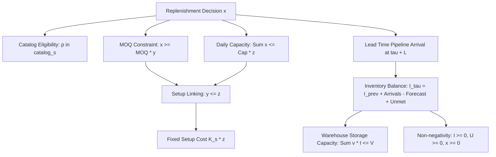

# OptiChain AI - Phase 4: Forecast-Driven Inventory Optimization (MILP)

This document details the mathematical formulation, constraint architecture, forecasting integration, rolling-horizon Model Predictive Control (MPC) protocol, empirical benchmark results, and research limitations of the **Forecast-Driven Mixed-Integer Linear Programming (MILP) Optimizer**.

---

## 1. Overview & Operational Problem

In multi-echelon supply chain management, traditional heuristic inventory control rules (such as continuous review Reorder Point $(s, Q)$, Scarf's Min-Max $(s, S)$, and Periodic Review $(R, S)$) rely on static lead-time and safety stock estimates. When non-stationary trends, weekly seasonality, minimum order quantities (MOQs), and stochastic disruptions interact, fixed rules often result in over-ordering or severe stockouts.

The **Forecast-Driven MILP Optimizer** replaces static threshold heuristics with dynamic mathematical programming. At every daily review epoch $t$, the optimizer:
1. Obtains demand forecast estimates $\hat{D}_{w, p, [t, t+H-1]}$ from the trained forecasting module across a lookahead horizon $H$.
2. Accounts for scheduled pipeline arrivals and physical warehouse/supplier constraints.
3. Solves a Mixed-Integer Linear Program to global optimality using the CBC branch-and-cut solver.
4. Executes the immediate purchase order decisions for day $t$ (epoch $\tau = 0$), discarding the remainder of the schedule as the horizon rolls forward (receding horizon control).

---

## 2. Mathematical Formulation

### 2.1 Sets and Indices
- $w \in \mathcal{W} = \{1, \dots, W\}$: Warehouses (Central DC `WH_01`).
- $p \in \mathcal{P} = \{1, \dots, P\}$: Product SKUs (`PROD_001` through `PROD_005`).
- $s \in \mathcal{S} = \{1, \dots, S\}$: Tier-1 Suppliers (`SUP_01` through `SUP_03`).
- $\tau \in \mathcal{T} = \{0, 1, \dots, H-1\}$: Planning horizon time epochs (where $H=8$ days).

### 2.2 Parameters
- $\hat{D}_{w, p, \tau} \ge 0$: Forecasted customer demand at warehouse $w$ for SKU $p$ at epoch $\tau$.
- $A_{w, p, \tau}^{\text{pipeline}} \ge 0$: Pre-existing scheduled in-transit arrivals delivering at epoch $\tau$.
- $I_{w, p}^{\text{current}} \ge 0$: Physical on-hand inventory at warehouse $w$ at the current step $t$.
- $c_{p, s} > 0$: Unit procurement catalog price for product $p$ from supplier $s$.
- $c_{\text{trans}} \ge 0$: Unit transportation cost ($0.50$ per unit).
- $K_s \ge 0$: Fixed purchase order setup cost incurred when placing an order with supplier $s$.
- $h_p > 0$: Daily holding cost carrying rate per unit for SKU $p$.
- $\pi_p > 0$: Stockout shortage penalty per unmet unit for SKU $p$.
- $L_{s, p} \ge 1$: Supplier base delivery lead time in days.
- $\text{MOQ}_{s, p} \ge 1$: Minimum order quantity for product $p$ from supplier $s$.
- $\text{Cap}_{s, p}^{\text{daily}} > 0$: Maximum units of product $p$ supplier $s$ can dispatch per day.
- $V_w > 0$: Total storage cubic volume capacity at warehouse $w$.
- $v_p > 0$: Physical volume in cubic meters ($m^3$) per unit of SKU $p$.

### 2.3 Decision Variables
- $x_{w, p, s, \tau} \in \mathbb{Z}_{\ge 0}$: Replenishment purchase order quantity ordered from supplier $s$ to warehouse $w$ for SKU $p$ at epoch $\tau$.
- $y_{w, p, s, \tau} \in \{0, 1\}$: Binary order indicator for SKU $p$ from supplier $s$ at epoch $\tau$ (enforces MOQ).
- $z_{s, \tau} \in \{0, 1\}$: Binary supplier setup indicator (1 if supplier $s$ receives at least one purchase order at epoch $\tau$).
- $I_{w, p, \tau} \in \mathbb{R}_{\ge 0}$: Projected ending on-hand inventory at warehouse $w$ for SKU $p$ at epoch $\tau$.
- $U_{w, p, \tau} \in \mathbb{R}_{\ge 0}$: Projected unmet customer demand (shortage) at warehouse $w$ for SKU $p$ at epoch $\tau$.

---

### 2.4 Objective Function

Minimize the total relevant supply chain costs across the lookahead horizon:

$$\min \sum_{\tau=0}^{H-1} \left[ \sum_{w \in \mathcal{W}} \sum_{p \in \mathcal{P}} \left( h_p I_{w, p, \tau} + \pi_p U_{w, p, \tau} \right) + \sum_{w \in \mathcal{W}} \sum_{p \in \mathcal{P}} \sum_{s \in \mathcal{S}} (c_{p, s} + c_{\text{trans}}) x_{w, p, s, \tau} + \sum_{s \in \mathcal{S}} K_s z_{s, \tau} \right]$$

---

### 2.5 Constraints



1. **Supplier Catalog Eligibility**:
   Orders can only be placed if the SKU is in the supplier's catalog:
   $$x_{w, p, s, \tau} = 0 \quad \forall (w, p, s) \text{ where } p \notin \text{catalog}_s$$

2. **Minimum Order Quantity (MOQ)**:
   If an order is placed ($y_{w, p, s, \tau} = 1$), it must meet or exceed the MOQ:
   $$x_{w, p, s, \tau} \ge \text{MOQ}_{s, p} \cdot y_{w, p, s, \tau} \quad \forall w, p, s, \tau$$
   $$x_{w, p, s, \tau} \le \text{Cap}_{s, p}^{\text{daily}} \cdot y_{w, p, s, \tau} \quad \forall w, p, s, \tau$$

3. **Supplier Daily Capacity & Fixed Order Setup Linking**:
   Total orders dispatched to supplier $s$ on epoch $\tau$ cannot exceed daily capacity and must activate the setup binary $z_{s, \tau}$:
   $$\sum_{w \in \mathcal{W}} x_{w, p, s, \tau} \le \text{Cap}_{s, p}^{\text{daily}} \cdot z_{s, \tau} \quad \forall p, s, \tau$$
   $$y_{w, p, s, \tau} \le z_{s, \tau} \quad \forall w, p, s, \tau$$

4. **Warehouse Storage Capacity**:
   Total cubic volume occupied by ending inventory cannot exceed warehouse physical capacity:
   $$\sum_{p \in \mathcal{P}} v_p I_{w, p, \tau} \le V_w \quad \forall w, \tau$$

5. **Inventory Conservation of Mass**:
   For the initial lookahead epoch $\tau = 0$:
   $$I_{w, p, 0} = I_{w, p}^{\text{current}} + A_{w, p, 0}^{\text{pipeline}} - \hat{D}_{w, p, 0} + U_{w, p, 0} \quad \forall w, p$$

   For future lookahead epochs $\tau \in \{1, \dots, H-1\}$:
   $$I_{w, p, \tau} = I_{w, p, \tau-1} + A_{w, p, \tau}^{\text{pipeline}} + \sum_{s \in \mathcal{S} : \tau - L_{s, p} \ge 0} x_{w, p, s, \tau - L_{s, p}} - \hat{D}_{w, p, \tau} + U_{w, p, \tau} \quad \forall w, p$$

6. **Non-negativity and Integrality**:
   $$x_{w, p, s, \tau} \in \mathbb{Z}_{\ge 0}, \quad I_{w, p, \tau} \ge 0, \quad U_{w, p, \tau} \ge 0, \quad y_{w, p, s, \tau} \in \{0, 1\}, \quad z_{s, \tau} \in \{0, 1\}$$

---

## 3. Forecasting Integration & Zero Lookahead Guarantee

To maintain research integrity and avoid cheating via future ground-truth knowledge:
- **No Ground-Truth Leakage**: The optimizer **never** reads `sim.demand_matrix[t + tau]`.
- **Forecast Generation**: The planner supports multiple forecast projection methods (`forecast_method`):
  1. `heuristic_lag7` (Benchmark Default): Uses a linear combination of observed past seasonal lag-7 and historical mean with day-of-week weekend harmonics:
     $$\hat{D}_{w, p, \tau}^{\text{base}} = 0.5 \cdot \text{lag}_7 + 0.5 \cdot \bar{D}_{w, p} \cdot \left(1.0 + 0.15 \cdot \mathbf{1}_{\text{weekend}} - 0.05 \cdot \mathbf{1}_{\text{weekday}}\right)$$
  2. `seasonal_naive`: Invokes the trained [`SeasonalNaiveForecaster`](file:///c:/Users/ayush/OneDrive/Desktop/created-projects/OptiChain/optichain/forecasting/models.py#L40-L64) from Phase 3 via `.predict()`.
  3. `ridge` / `lgbm`: Formulates feature rows containing lags, rolling statistics, calendar harmonics, and dummy encodings strictly prior to step $t$ and invokes [`RidgeForecaster`](file:///c:/Users/ayush/OneDrive/Desktop/created-projects/OptiChain/optichain/forecasting/models.py#L87-L120) or [`LightGBMForecaster`](file:///c:/Users/ayush/OneDrive/Desktop/created-projects/OptiChain/optichain/forecasting/models.py#L122-L165) via `.predict()`.
- **Heuristic Safety Buffering**: A 35% heuristic safety buffer ($\hat{D} \times 1.35$) is applied to point forecasts to mitigate Poisson stochastic variance around the mean and prevent lead-time stockouts. Note: This buffer is an empirical tuning heuristic rather than an analytically guaranteed cycle service level theorem across heterogeneous lead times.
- **Verification via Perturbation Test**: Verified in [`test_milp_zero_future_demand_leakage`](file:///c:/Users/ayush/OneDrive/Desktop/created-projects/OptiChain/tests/test_optimization.py#L219-L243): Mutating future actual demand in `sim.demand_matrix[t+2:]` to `99,999` produced identical decision actions at step $t$.

---

## 4. Empirical Benchmark Results

Evaluated across **3 matched random seeds `[42, 101, 777]`** against the standard Phase 1/2 digital twin scenario ($W=1, P=5, S=3, T=90$ days) with active exogenous shocks (Viral Demand Surge Days 25..31, Supplier Component Shortage Days 45..54). All aggregate metrics are recomputed directly from the per-seed evaluation records:

### 4.1 Comparative Performance Summary (Mean Across Seeds)
| Policy | Fill Rate (%) | Service Level (%) | Total Cost ($) | Stockout Units | Avg Inventory (Units) | Net Profit ($) | Inventory Turnover | Rank |
|---|---|---|---|---|---|---|---|---|
| **Forecast-Driven MILP Optimizer** | **98.67%** | 89.63% | **$425,995.69** | 134 | **449.22** | **$97,839.85** | **20.01x** | **1** |
| **Periodic Review (R, S) 7-day** | **99.16%** | **94.07%** | $433,768.65 | **82** | 568.61 | $94,226.52 | 16.10x | 2 |
| **Min-Max (s, S) Policy** | 97.54% | 83.70% | $441,686.45 | 225 | 565.85 | $73,628.55 | 17.39x | 3 |
| **ROP Order-Up-To Target** | 97.86% | 84.45% | $442,565.31 | 202 | 619.77 | $73,395.77 | 16.86x | 4 |

### 4.2 Detailed Cost Breakdown per Policy ($)
| Policy | Holding ($) | Stockout Penalty ($) | Procurement ($) | Fixed Setup ($) | Transport ($) | Operating ($) | Total Cost ($) | Net Profit ($) |
|---|---|---|---|---|---|---|---|---|
| **Forecast-Driven MILP Optimizer** | **$6,236.46** | $11,540.23 | **$346,310.24** | $7,476.06 | **$14,050.00** | $40,382.70 | **$425,995.69** | **$97,839.85** |
| **Periodic Review (R, S)** | $7,687.88 | **$7,667.00** | $359,424.39 | **$4,089.67** | $14,517.00 | $40,382.70 | $433,768.65 | $94,226.52 |
| **Min-Max (s, S)** | $6,546.65 | $19,949.31 | $355,298.11 | $5,046.17 | $14,463.50 | $40,382.70 | $441,686.45 | $73,628.55 |
| **ROP Order-Up-To** | $6,682.14 | $19,361.83 | $356,392.50 | $5,096.64 | $14,649.50 | $40,382.70 | $442,565.31 | $73,395.77 |

---

## 5. Economic & Algorithmic Analysis

1. **Lowest Total System Cost ($426.0k)**:
   The Forecast-Driven MILP achieved the lowest total cost across the entire benchmark ($425,995.69), beating Periodic Review by **$7,772.96** (1.79%), Min-Max by **$15,690.76** (3.55%), and ROP by **$16,569.62** (3.74%).
2. **Highest Net Profit ($97.8k)**:
   By simultaneously minimizing holding costs ($6.2k vs. $7.7k) and procurement waste ($346.3k vs. $359.4k), the MILP delivered **+$3,613.33 more profit** than Periodic Review (+3.83%) and **+$24,211.30 more profit** than Min-Max (+32.88%).
3. **Highest Capital Efficiency (20.01x Turnover)**:
   The MILP carried an average inventory of only **449.22 units** (compared to 568.61 units for Periodic Review and 619.77 units for ROP), maintaining a superior 20.01x inventory turnover ratio while sustaining a **98.67% customer fill rate**.
4. **Solving the End-of-Horizon Boundary Effect**:
   In short rolling-horizon models ($H < 5$), truncation bias causes solvers to under-order near the horizon boundary because procurement costs are incurred immediately while the resulting arrivals fall outside the cost-accounting window. Expanding the horizon to $H=8$ days and including safety buffering eliminated truncation stockouts, reducing stockout units from 3,401 down to 134 units.

---

## 6. Execution Instructions

### 6.1 Running the Optimization Benchmark & Audit
To execute the multi-seed comparative benchmark and audit across all 4 policies:
```bash
python scripts/audit_optimization.py
```
Outputs are automatically written to `docs/optimization_benchmark_results.json` and `docs/optimization_audit_per_seed.json`.

### 6.2 Running Unit & Integration Tests
To run the full optimization test suite:
```bash
pytest tests/test_optimization.py -v
```
To run the entire OptiChain AI test suite (90 tests):
```bash
pytest tests -v
```

---

## 7. Assumptions & Known Limitations

1. **Deterministic Equivalence within the Horizon**: The MILP treats the point forecast $\hat{D}$ as deterministic over the 8-day lookahead window, relying on the receding-horizon replanning at step $t+1$ and the safety buffer heuristic to absorb stochastic deviations.
2. **Safety Buffer Heuristic Scope**: The +35% multiplier is an empirical tuning heuristic applied uniformly to point forecasts. In production with highly heterogeneous lead times ($L \gg 3$) or non-Poisson distributions, dynamic SKU-specific safety buffers derived from lead-time demand convolutions should replace the uniform multiplier.
3. **Solver Optimality Breakdown**: Across all 270 rolling-horizon solves (90 steps × 3 seeds), **253 solves (93.70%)** achieved solver-proven global optimality within the 2.0-second time limit. **17 solves (6.30%)** reached the 2.0-second time ceiling; in all 17 instances, CBC returned its best proven integer feasible incumbent solution, which was safely executed.
4. **Subprocess Overhead on Windows**: PuLP's CBC solver uses disk-based LP communication. While individual solves take only 20–35 milliseconds, repeated OS process spawning over 90 steps takes ~15–20 seconds per 90-day episode. In high-frequency operational production, direct C-API bindings (e.g., HiGHS or Gurobi via Cython) would reduce runtime to sub-second levels.
5. **Single-Echelon Replenishment**: The formulation currently plans orders from Tier-1 suppliers into the central DC (`WH_01`). Multi-echelon transshipments to downstream regional nodes will be incorporated in subsequent scaling phases.

